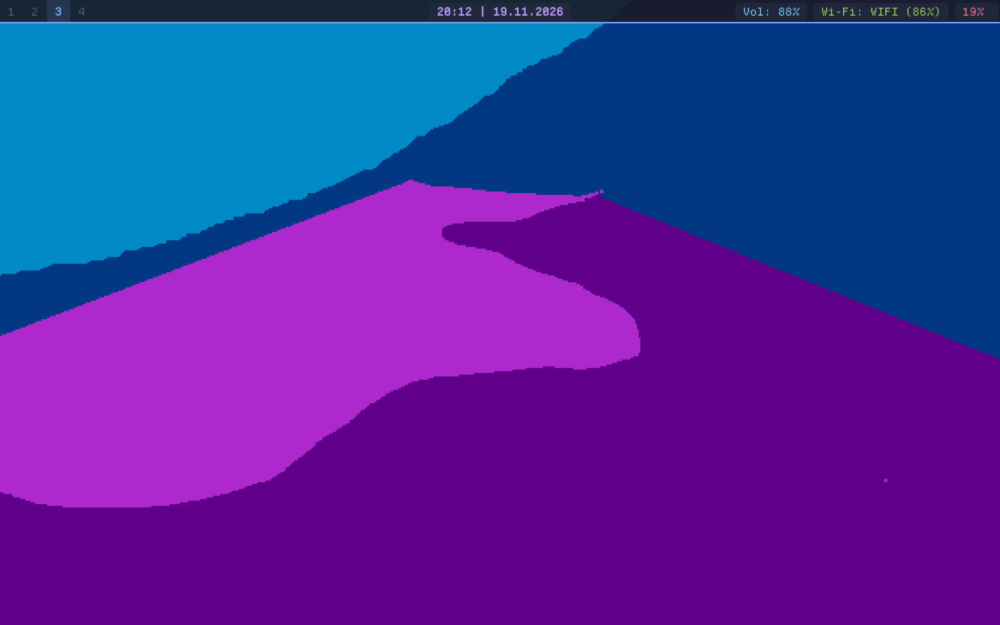
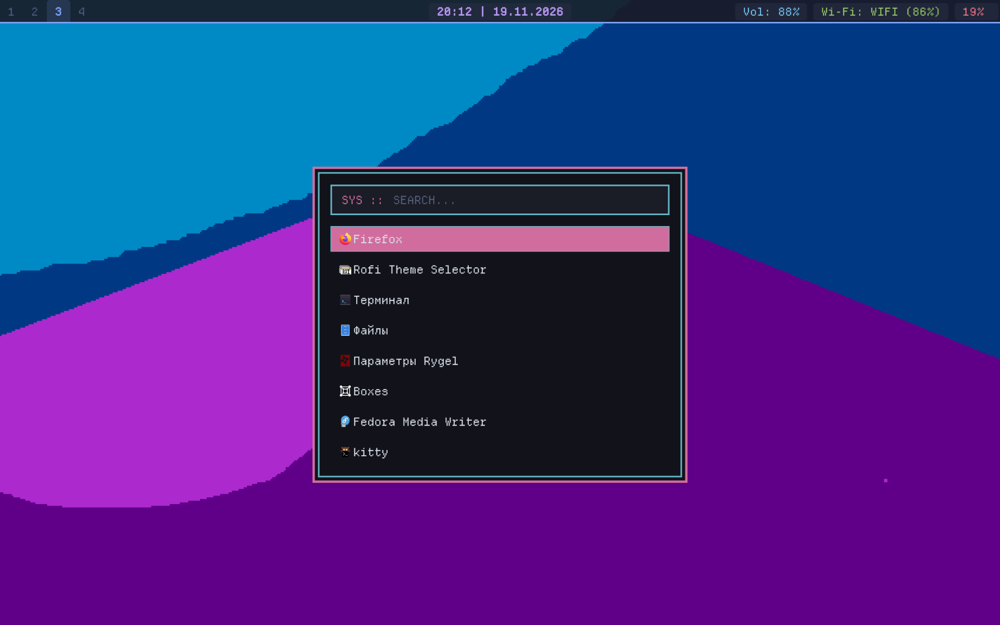
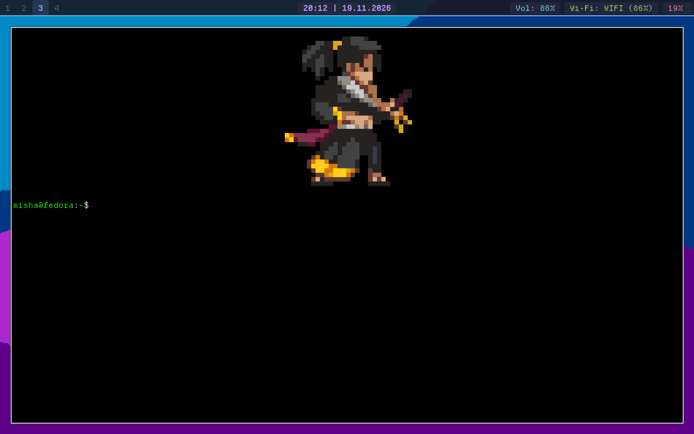

# Muted Cyberpunk — Hyprland Dotfiles

Минималистичный пиксельный райз для **Hyprland** (на базе **Lua API**) в сдержанной неоново-графитовой палитре **Muted Cyberpunk**. Оформление построено на острых углах (`0px`), чётких пиксельных рамках и моноширинном шрифте без лишних иконок.

## Скриншоты



| Меню Rofi | Терминал Kitty |
| :---: | :---: |
|  |  |

---

## Компоненты системы

* **Композитор:** Hyprland (`hyprland.lua`)
* **Панель:** Waybar
* **Лаунчер и меню:** Rofi (`config.rasi` + тема `pixel.rasi`)
* **Терминал:** Kitty
* **Шрифт:** DepartureMono Nerd Font
* **Буфер обмена и сеть:** `cliphist` + `wl-clipboard`, `nm-applet`
* **Звук:** WirePlumber (`wpctl`)

---

## Цветовая палитра (Muted Cyberpunk)

| Назначение | HEX | Описание |
| :--- | :--- | :--- |
| **Background** | `#12131a` | Тёмно-графитовый основной фон |
| **Background Alt** | `#1a1c26` | Фон панелей, модулей и строки поиска |
| **Foreground** | `#d8dee9` | Приглушённый светло-серый текст |
| **Accent Pink** | `#d16d9e` | Сдержанный неоново-розовый акцент |
| **Accent Cyan** | `#64b5c6` | Спокойный бирюзовый неон |
| **Muted** | `#565f78` | Втостепенные элементы и подсказки |

---

## Структура репозитория

```text
my-rice/
├── hypr/
│   └── hyprland.lua    # Конфигурация Hyprland (стили, раскладка, автозапуск и бинды)
├── waybar/
│   ├── config.jsonc    # Модули верхней панели
│   └── style.css       # Пиксельный стиль Waybar
├── rofi/
│   ├── config.rasi     # Настройки режимов (SYS ::, CMD ::, WIN ::) и поиска fzf
│   └── pixel.rasi      # Цветовая тема Muted Cyberpunk
├── kitty/
│   └── kitty.conf      # Конфигурация терминала Kitty
├── wallpapers/         # Файл обоев рабочего стола
├── screenshots/        # Скриншоты для README
└── README.md           # Документация и инструкция по установке
```

---

## Горячие клавиши

Основной модификатор (`$mainMod`) — клавиша **`SUPER`** (`Win`).

### Приложения и система

| Комбинация | Действие |
| :--- | :--- |
| `SUPER + Q` | Открыть терминал (`kitty`) |
| `SUPER + D` | Открыть меню запуска приложений (`rofi`) |
| `SUPER + B` | Скрыть / показать панель `Waybar` |
| `SUPER + U` | Открыть историю буфера обмена (`cliphist` + `rofi`) |
| `SUPER + M` | Завершить сессию Hyprland |
| `Alt + Shift` | Переключить раскладку клавиатуры (`EN` / `RU`) |

### Управление окнами и рабочими столами

| Комбинация | Действие |
| :--- | :--- |
| `SUPER + C` | Закрыть активное окно |
| `SUPER + V` | Переключить плавающий режим окна |
| `SUPER + SHIFT + Стрелки` | Переместить окно в выбранном направлении |
| `SUPER + ЛКМ / ПКМ` | Перетаскивание и изменение размера окна мышью |
| `SUPER + [1–5]` | Переключиться на рабочий стол `1–5` |
| `SUPER + SHIFT + [1–5]` | Переместить активное окно на рабочий стол `1–5` |
| `SUPER + CTRL + Left / Right` | Перейти на предыдущий / следующий рабочий стол |

### Звук

| Комбинация | Действие |
| :--- | :--- |
| `XF86AudioRaiseVolume` / `F6` | Увеличить громкость (`+5%`) |
| `XF86AudioLowerVolume` / `F5` | Уменьшить громкость (`-5%`) |
| `XF86AudioMute` | Включить / выключить звук (`Mute`) |

---

## Установка и применение

### 1. Установите зависимости
Пример установки необходимых пакетов в **Fedora**:
```bash
sudo dnf install hyprland waybar rofi-wayland kitty wl-clipboard cliphist network-manager-applet wireplumber
```
Также убедитесь, что в системе установлен шрифт **DepartureMono Nerd Font** (например, в `~/.local/share/fonts/` с обновлением кэша через `fc-cache -fv`).

### 2. Сделайте резервную копию текущих настроек
Перед установкой обязательно сохраните свои текущие конфиги, чтобы при необходимости вернуть всё обратно:
```bash
mkdir -p ~/.config_backup
cp -r ~/.config/{hypr,waybar,rofi,kitty} ~/.config_backup/ 2>/dev/null
```

### 3. Скопируйте файлы райза
*(Если в папке `~/.config/hypr/` у вас остался старый файл `hyprland.conf`, удалите или переименуйте его, чтобы Hyprland читал новый `hyprland.lua`).*

```bash
git clone https://github.com
cd Chill-neon-pixel-rice

mkdir -p ~/.config/{hypr,waybar,rofi,kitty}
cp -r hypr/* ~/.config/hypr/
cp -r waybar/* ~/.config/waybar/
cp -r rofi/* ~/.config/rofi/
cp -r kitty/* ~/.config/kitty/
```

### 4. Адаптируйте под своё железо и примените
1. Узнайте имя вашего монитора командой `hyprctl monitors` и при необходимости замените `DP-1` в `~/.config/hypr/hyprland.lua` на своё значение.
2. Укажите путь к файлу обоев из папки `wallpapers/` в вашей утилите обоев (`hyprpaper` или `swww`).
3. Перезагрузите конфигурацию:
```bash
hyprctl reload && hyprctl configerrors
```
